<p align="center">
  
</p>

<h1 align="center">Next Unlocks</h1>

<p align="center">See what your next levels unlock in every skill, straight from the game's own skill guide.</p>

<p align="center">
  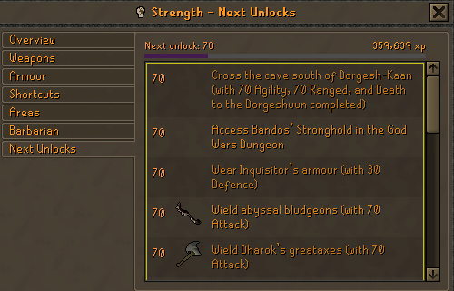
</p>

## Features

### Skill guide
The game's skill guide gets a **Next Unlocks** tab listing what your next levels unlock, plus a progress bar to your next unlock above the list.
On the guide's own tabs, your next unlock is highlighted (and the ones after it can be faded), rows reached with a boost are marked green, quest-locked rows are greyed out, the list scrolls to your next unlock, and sections you've hidden are dimmed.
Each part can be turned off.

<p align="center">
  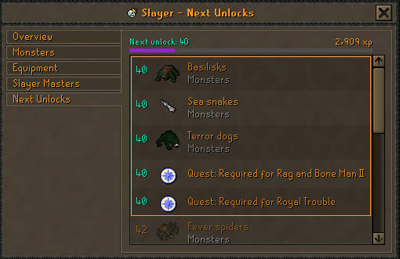
</p>

### Skills tab tooltip
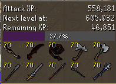

Hover a skill to see its next unlock level, the XP left, a progress bar and the unlocks' icons, or only the icons.
It can take over the game's XP tooltip so the two don't overlap, and its icon size, text size and background opacity are adjustable.

Right-click a skill and choose **Pin** to keep its tooltip on screen above the chatbox. Right-click it again to unpin. With split private chat on, pinned cards move up above your private messages so they never cover them.
Pinned cards sit side by side at the same height and show the skill and your level, and their XP and progress update as you train.
By default every skill gets its own card, tuned to the skill's colour and feel: a parchment scroll for Cooking, a dark blood-red scroll for Slayer, frosted glass for Fishing, a gilded frame for Prayer, a dusky rose window for Magic, and so on for all 24 skills including Sailing. Many have their own frame and something alive on them: riveted plates for Strength, Smithing and Mining, cut corners for Attack and Woodcutting, corner brackets for Ranged and Agility, ornate trim for Prayer and Crafting, a pixel-stepped edge for Runecraft, a dashed edge for Thieving; embers drifting up in Firemaking and Smithing, bubbles in Fishing and Herblore, fireflies in Farming, runes in Runecraft; and a border that pulses, flickers like a forge, marches or has a light running around it. The skill's icon sits before its name, as tall as the text.
Cards also come in shared styles (Classic RuneLite, 90s arcade, Neon synthwave, CRT terminal, Handheld, Windows 95, Modern, Minimal, Parchment scroll, RuneScape stone, Gilded, Frosted glass), with a choice of font, progress bar, level-up effect, glow and text shadow, background and bar gradients, a shimmer, border width, rounded corners, padding and a title band, a frame shape (classic, flat, double, raised, rounded, cut corners, riveted, corner brackets, ornate, pixel or dashed), border motion (pulse, running light, rainbow, marching or flicker), ambient particles inside the card (embers, bubbles, snow, fireflies, sparkles, leaves, runes or dust), and every color can be set by hand.
Each skill's card can have its own look on top of the shared one, and any look can be saved as a named preset to load, rename or delete later.
As you gain XP, the card can throw off an effect from the end of its bar (sparks, embers, bubbles, leaves, stars, pixels, runes, hearts, coins, smoke or lightning, or Auto to match the skill), float the XP gained up off the bar, and flash the bar.

<p align="center">
  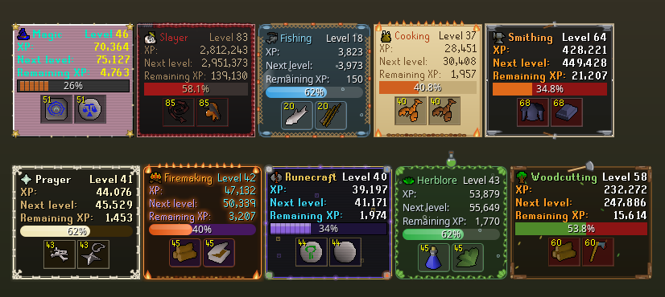
</p>
<p align="center">
  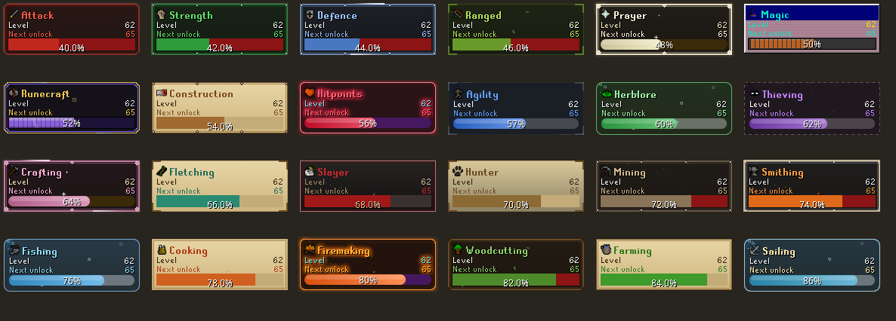
</p>
**Set goal** on the same menu picks one of the next few unlocks, the next level or 99, or **Choose level...** to type any level; the nearest goal shows as a bar in the skill's color on its card, running from your XP when you set the goal to the goal's XP.

**Combat level**: right-click any combat skill (Attack, Strength, Defence, Hitpoints, Ranged, Magic or Prayer) and choose **Pin** on *Combat level*. The card shows your combat level and its exact value, a bar to the next level, and how many levels of each combat skill on its own would get you there. **Set goal** on *Combat level* picks the next level, 126 or any level you type; the card then lists the levels each skill needs for the goal too, with a bar that runs from where you were when you set it to the goal. Right-click the card to change the goal or unpin it. It has its own look by default, dark stone with notched corners and drifting embers, and you can change it apart from the skill cards by picking **Combat level** under Cards to change in the Looks tab.
Turn on **Combat level at top** (in the settings, or **Top of screen** under Combat level in the in-game menu's Pins tab) to keep your combat level, with a thin bar to the next level, in a small plate at the top middle of the screen. It uses the combat level card's look; right-click it to set a goal, pin the card or hide it. Hold Alt to drag it somewhere else.

Quests and achievement diaries can be pinned too: right-click a quest in the quest list, or a quest or diary in the side panel, and choose **Pin**. The card shows the quest or diary icon and its name in large text.
The card lists the hard requirements (skill levels, quest points, combat level and the quests needed first), unmet in red first, then met in green. Diary cards list skill levels only.
A pinned quest unpins itself with a chat message once you finish it.

**Item goals**: pin an item you're working towards, like the Ironwood blowpipe or a Void Knight top. Right-click the item in your inventory, bank, equipment or a shop, or any item row in the in-game skill guide (the game's tabs and the Next Unlocks tab), and choose **Pin**, or search for it in the side panel and click it. The card lists the levels and quests needed to wield or wear it and, for ironmen, the levels needed to make it from scratch, with the material a level is for, like Ironwood logs under Woodcutting, on a small line of its own with a tiny icon of it. Turn off **Item goals: making levels** under Goals to see only the wield and wear requirements. The card says **Ready** once you meet them all.

<p align="center">
  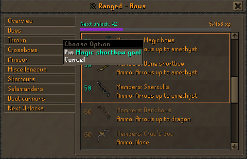
  &nbsp;&nbsp;
  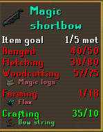
</p>

**Spells, prayers and other unlocks**: right-click a row in the in-game skill guide, or an unlock in the side panel, and choose **Pin**. The card shows its level and the quest it needs. Under any unfinished quest on a card, in the same small text as materials, are the levels and quests that quest still needs.

**Check off**: right-click a pinned card and open **Check off** to tick a requirement off by hand, like a quest the plugin can't see as done. Ticked requirements count as met and say Done. Untick them the same way. Unpinning the card forgets them.

**Amount goals**: right-click an item row in the skill guide, or an item unlock in the side panel, and choose **Set amount goal**, then type a number like 500 or 2k. You get a card like "Catch 500 Raw lobster" with a bar in the skill's color. Items count when they arrive in your inventory while the skill gains XP. For Firemaking, Prayer and Construction, items count when they're used up. The wording follows the skill: catch, chop, mine, cook, burn, bury and so on. Right-click the card to change the amount, reset the count or unpin it. Items that go straight into a fish barrel, log basket or similar aren't counted.

<br clear="right">

<p align="center">
  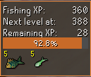
</p>

### Side panel
<p align="center">
  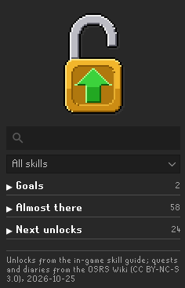
  &nbsp;&nbsp;
  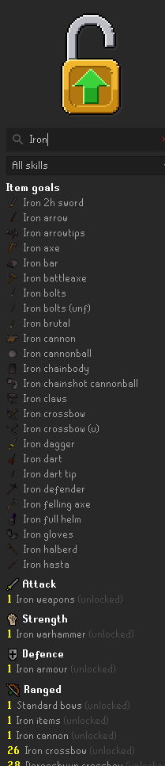
</p>

- Every skill sorted by the closest upcoming unlock, or one skill's next few unlock levels.
- Items, spells and prayers show as their in-game icons with the level on them. Hover for the name and XP left, click to open it on the OSRS Wiki.
- Goals, Almost there and Next unlocks are sections you can fold away, each with its count.
- Search any unlock across all skills, and see whether you have it yet. Matching item goals come first; click one to pin it.
- Hide whole skill guide sections per skill.
- **Goals**: right-click any unlock and pick **Set as goal**. Goals sit at the top of the panel with the XP left, and show as infoboxes; right-click the infobox to remove one. Reaching a goal posts a chat message and a notification, then clears it.
- **Almost there**: quests and achievement diaries where every skill requirement but one is met, closest first, and quests that are the only thing between you and unlocks you already have the level for. Click one to open it on the wiki. Diary completion isn't checked, so finished diaries can still show up.

### Also
- **Level-up message**: a chat message listing what the level you just reached unlocks, with the skill and level in grey and the unlocks in yellow by default, both changeable under Colors, with an optional text shadow.

  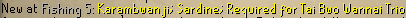

- **Boosts**: unlocks your boosted level reaches count as reached for things the game lets you do boosted (skilling methods, spells, shortcuts, quests, diaries), but not equipment or prayers.
- **Quest-locked unlocks**: unlocks that need a quest you haven't finished are greyed out.
- **Filters**: members content (always, never, or match the world), quest and diary requirements, how many levels to list.
- **In-game menu**: a small button on the minimap's rim opens a menu in the game's own window style, so everything can be done without the side panel. It has four tabs:
  - **Looks**: pick which cards to change (all skills, or one skill for its own look), then four sub-tabs: **Style** (style, font, bar, glow, text shadow, scanlines, skill icon, text and icon size), **Frame** (gradients, title band, shimmer, frame shape, border, border motion, corners, padding, opacity), **Effects** (XP effect, ambient particles, XP popup, bar pulse, level-up flash) and **Presets** (save, load, rename and delete looks). A reset for all skills needs a second click; a skill's own look can be dropped to match the rest.
  - **Goals**: your goals with the XP left to each one. Pick a skill to add its next unlocks, the next level, 99 or a level you type.
  - **Pins**: pin skills from a grid, and remove pinned quests, diaries and items. You can also pin one by typing its name.
  - **Options**: the remaining switches.

  Drag the title bar to move the menu, double-click it to centre it again, and press Escape to close it. The button's place on the rim can be changed if it sits on top of another plugin's button.

## Settings

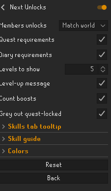

- **General**: members unlocks, quest and diary requirements, levels to show, level-up message, boosts, greying out quest-locked unlocks.
- **Skills tab tooltip**: on/off, icons only (on by default), including the game's XP tooltip, progress bar, icon and text size, background opacity, outline, the level and goal bar on pinned cards.
- **Pinned card style** and **Pinned card colors**: the card style, font, bar, level-up effect, XP effect, XP popup and bar pulse, glow, text shadow, scanlines, skill icon, gradients, shimmer, frame shape, border, border motion, ambient particles, corners, padding, title band and each color.
- **Goals**: goal infoboxes, the goal-reached notification, the Almost there list, whether item goals count making levels.
- **Skill guide**: the Next Unlocks tab, highlighting, fading, markings, progress bar, scrolling, dimming hidden sections.
- **In-game menu**: the minimap button on/off and its place on the rim.
- **Colors**: next unlock, outline, progress bar and its background, level numbers, boost-reached and quest-locked, used by the tooltip, the side panel and the skill guide; plus the level-up message's skill/level and unlocks colors and its text shadow.

<br clear="right">

## Data

Unlocks come from the game's own skill guide, read from the client's cache, so their names and icons match the in-game guide.
Quest and diary requirements come from the OSRS Wiki "Level up table" pages, which ship with the plugin, so it makes no network requests; the wiki's unlocks are also used until the cache is loaded.
Item goals come from the wiki too: wield and wear levels and quests from each equipment page's opening sentences (the wiki keeps them in no structured field, so a few items are missing or off), and making levels from its recipes, following each material down to the level that gathers it. Once the game cache is read, the skill guide adds its own levels for each item it lists, including the levels it lists only under other skills, and items the wiki data lacks become goals of their own.
Refresh the wiki data with:

```
python3 -I tools/fetch_unlocks.py
python3 -I tools/fetch_quests.py
python3 -I tools/fetch_items.py
```

Wiki content is licensed under [CC BY-NC-SA 3.0](https://creativecommons.org/licenses/by-nc-sa/3.0/); see https://oldschool.runescape.wiki.

## Development

```
./gradlew run     # starts RuneLite with the plugin loaded
./gradlew test
```
