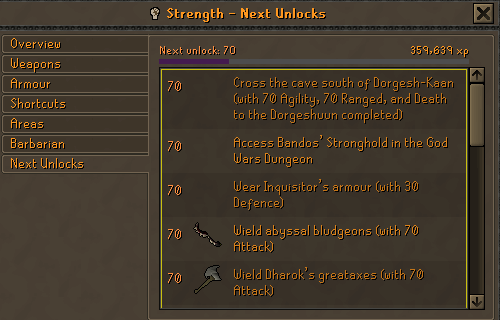
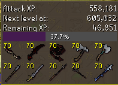
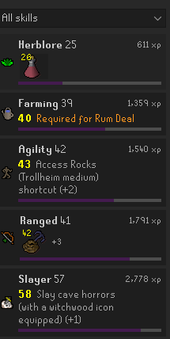
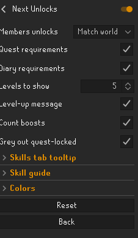

<p align="center">
  
</p>

<h1 align="center">Next Unlocks</h1>

<p align="center">See what your next levels unlock in every skill, straight from the game's own skill guide.</p>

<p align="center">
  
</p>

## Features

### Skill guide
The game's skill guide gets a **Next Unlocks** tab listing what your next levels unlock, plus a progress bar to your next unlock above the list.
On the guide's own tabs, your next unlock is highlighted (and the ones after it can be faded), rows reached with a boost are marked green, quest-locked rows are greyed out, the list scrolls to your next unlock, and sections you've hidden are dimmed.
Each part can be turned off.

### Skills tab tooltip


Hover a skill to see its next unlock level, the XP left, a progress bar and the unlocks' icons, or only the icons.
It can take over the game's XP tooltip so the two don't overlap, and its icon size, text size and background opacity are adjustable.

Right-click a skill and choose **Pin** to keep its tooltip on screen above the chatbox. Right-click it again to unpin.

<br clear="right">

### Side panel


- Every skill sorted by the closest upcoming unlock, or one skill's next few unlock levels.
- Items, spells and prayers show as their in-game icons with the level on them. Hover for the name and XP left, click to open it on the OSRS Wiki.
- Search any unlock across all skills, and see whether you have it yet.
- Hide whole skill guide sections per skill.

<br clear="right">

### Also
- **Level-up message**: a chat message listing what the level you just reached unlocks.
- **Boosts**: unlocks your boosted level reaches count as reached for things the game lets you do boosted (skilling methods, spells, shortcuts, quests, diaries), but not equipment or prayers.
- **Quest-locked unlocks**: unlocks that need a quest you haven't finished are greyed out.
- **Filters**: members content (always, never, or match the world), quest and diary requirements, how many levels to list.

## Settings



- **General**: members unlocks, quest and diary requirements, levels to show, level-up message, boosts, greying out quest-locked unlocks.
- **Skills tab tooltip**: on/off, icons only, including the game's XP tooltip, progress bar, icon and text size, background opacity, outline.
- **Skill guide**: the Next Unlocks tab, highlighting, fading, markings, progress bar, scrolling, dimming hidden sections.
- **Colors**: next unlock, outline, progress bar and its background, level numbers, boost-reached and quest-locked, used by the tooltip, the side panel and the skill guide.

<br clear="right">

## Data

Unlocks come from the game's own skill guide, read from the client's cache, so their names and icons match the in-game guide.
Quest and diary requirements come from the OSRS Wiki "Level up table" pages, which ship with the plugin, so it makes no network requests; the wiki's unlocks are also used until the cache is loaded.
Refresh the wiki data with:

```
python3 -I tools/fetch_unlocks.py
```

Wiki content is licensed under [CC BY-NC-SA 3.0](https://creativecommons.org/licenses/by-nc-sa/3.0/); see https://oldschool.runescape.wiki.

## Development

```
./gradlew run     # starts RuneLite with the plugin loaded
./gradlew test
```
